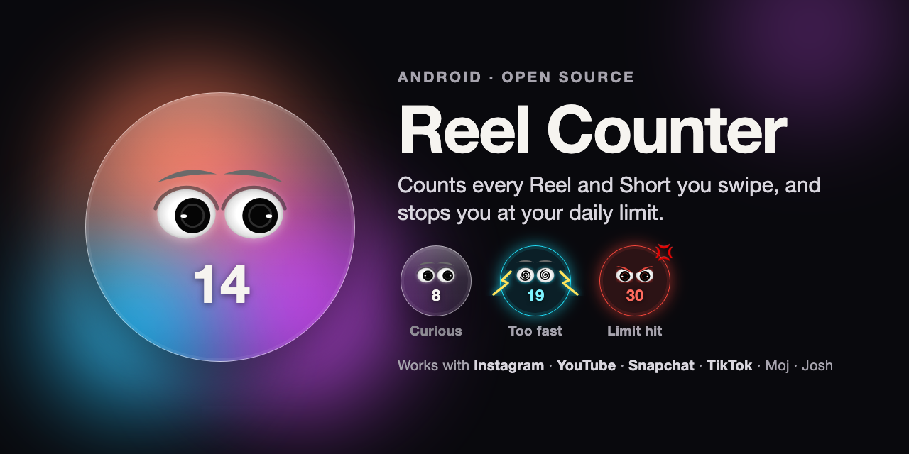
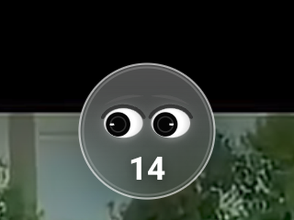

# Rokoreels



**Every reel, counted.** Rokoreels is an Android app that counts the Reels and Shorts you swipe
through, shows the count with Iris (a little face by your camera whose mood follows your day),
and helps you stop when you mean to.



## Features

- **One count across apps.** Instagram Reels, YouTube Shorts, Snapchat Spotlight, TikTok, Moj
  and Josh all add to the same daily number.
- **Iris over reel apps.** A glass face by the camera with today's count and your time in the
  app. She's calm when the count is low, gets curious, worried and sad as you near your limit,
  and angry at it. Scroll fast and she's electrocuted; stop for a while and she dozes off.
  Hold and drag her anywhere; tap to poke her.
- **Home, one screen.** Iris in a ring that fills with your day, reels and minutes today, one
  sentence about how it's going, and your top three apps. No scrolling.
- **Progress.** This week or this month: days under your limit (a calendar for the month),
  compared with the week or month before and time saved, your streak, when in the day reels
  get you, and each app's trend. Phone screen time is one tap away.
- **Rules per app.** Block an app's Reels outright, give it its own reel limit, or a daily timer
  for the whole app. Everything about an app lives on its own page.
- **Daily limit.** At your limit, Reels, Shorts and Spotlight close until midnight; the rest of
  each app keeps working. TikTok, Moj and Josh close entirely, since they're only short videos.
- **Focus hours.** Lock chosen apps on a schedule (Work, Study, Sleep, Gym or your own), with
  an emergency unlock of 5 minutes, twice a day.
- **Pause before opening.** After a few free opens a day (3, 5 or 10), opening a reel app
  shows a short countdown first, with Close as the big button.
- **Four themes.** Dark (Night Garden, the default), Light (Paper), Royal (purple and gold) and
  System.
- **Home-screen widgets.** Iris in her ring with today's count, and a dashboard with your top
  apps and the week.

What's on your screen never leaves your phone. Signing in with Google is optional, and the app
sends anonymous usage stats (which you can turn off). See [Permissions and privacy](#permissions-and-privacy).

## Install

1. Build the APK (see [Build](#build)) or download it from the
   [Releases](https://github.com/Bhaskar-2110/reel-counter-android/releases) page when one is
   published.
2. Copy it to your phone and open it. Allow **Install unknown apps** for the app you opened it
   from (Files, Chrome, Drive…). If Play Protect warns you, tap **More details → Install anyway**.

Requires Android 8.0 or newer.

## Set up

The first-run tour walks through this in six short steps.

| Step | Why |
|---|---|
| Pick your apps | Which apps are counted |
| Allow usage access (optional) | Shows what reels cost you last week, and screen time per app |
| Set your limit | 30 a day is the default |
| Turn on **Rokoreels** in Accessibility settings | Detects the Reels/Shorts screen and your swipes |
| Allow notifications and unrestricted battery | Keeps counting running in the background |

On Android 13 and newer, the Accessibility switch is greyed out for apps installed outside the
Play Store. Open **Settings → Apps → Rokoreels → ⋮ → Allow restricted settings**, then turn
it on again.

On **OnePlus / OxygenOS** and similar phones, also lock Rokoreels in Recent apps, or the system
may stop counting after a while. **Settings → More → Permissions** shows what's missing.

## Permissions and privacy

| Permission | Used for |
|---|---|
| Accessibility service | Knowing when a Reels/Shorts/Spotlight screen is open, counting swipes, showing Iris and the pause and block screens. It doesn't read messages or what you type, and ignores apps it doesn't support. |
| Usage access | Screen time and opens per app. |
| Foreground service and notifications | The ongoing "N reels today" notification that keeps counting alive (can be turned off in More). |
| Ignore battery optimizations | Asking Android not to stop the app in the background. |
| Internet | Optional Google sign-in (Firebase Authentication) and anonymous usage stats (Google Analytics for Firebase). |

Counts and settings are stored in the app's private storage on the phone. Nothing the
Accessibility service sees on screen is ever sent.

**Anonymous usage stats** (on by default, **More → Share anonymous usage stats** turns them off)
go to Google Analytics for Firebase: onboarding steps finished, permissions granted, limit
changes, when a limit, pause or block screen happens, sign-in/sign-out, and once a day
yesterday's reel total per app, minutes and whether you stayed under your limit. No names,
emails or advertising ID, and the stats aren't linked to your account.
If you sign in, Firebase keeps your Google name and email to identify your account.
Android's own backup may copy counts and settings to a new phone; the crash log never leaves it.

## Supported apps

| App | Counted | How it's recognised |
|---|---|---|
| Instagram Reels | ✅ | Reels viewer screen |
| YouTube Shorts | ✅ | Shorts player progress bar |
| Snapchat Spotlight | ✅ | Spotlight viewer text changes |
| TikTok, Moj, Josh | ✅ | Whole app (it's all short videos) |

Apps sometimes rename their internal screens in updates. If one stops being counted, see
[If an app stops being counted](#if-an-app-stops-being-counted).

## Build

Needs JDK 17 or 21 and the Android SDK (compile SDK 35).

```bash
git clone https://github.com/Bhaskar-2110/reel-counter-android.git
cd reel-counter-android
./gradlew assembleDebug        # app/build/outputs/apk/debug/app-debug.apk
./gradlew testDebugUnitTest    # unit tests
./gradlew assembleRelease      # shrunk with R8; sign it before installing
```

Or open the folder in Android Studio and press **Run ▶** with your phone connected.

Google sign-in needs a Firebase project: add an Android app `com.reelcounter` with your signing
key's SHA-1, enable **Authentication → Google**, and put its `google-services.json` in `app/`
(it's git-ignored). Without the file the app still builds, and sign-in shows as not set up.

## How it works

A swipe is counted when a full-screen feed stops scrolling on a new item. For Instagram, YouTube
and Snapchat, the service first checks that the Reels/Shorts/Spotlight player is on screen, so
scrolling the normal feed isn't counted. Scrolling inside comment sheets and share menus is
ignored because those views don't fill the screen.

| File | Role |
|---|---|
| [`ReelCounterService.kt`](app/src/main/java/com/reelcounter/ReelCounterService.kt) | Accessibility service: recognises short-video screens, counts swipes, shows Iris and the pause and block screens |
| [`Platform.kt`](app/src/main/java/com/reelcounter/Platform.kt) | The supported apps and how each one's short-video screen is recognised |
| [`CountStore.kt`](app/src/main/java/com/reelcounter/CountStore.kt) | Daily counts, time, opens, limit and settings |
| [`Blocking.kt`](app/src/main/java/com/reelcounter/Blocking.kt) | Per-app blocking, focus hours and emergency unlocks |
| [`IrisRig.kt`](app/src/main/java/com/reelcounter/IrisRig.kt), [`IrisRenderer.kt`](app/src/main/java/com/reelcounter/IrisRenderer.kt) | Iris: her moods, springs and drawing |
| [`IslandView.kt`](app/src/main/java/com/reelcounter/IslandView.kt) | Iris over other apps, with the rolling count and timer |
| [`MainActivity.kt`](app/src/main/java/com/reelcounter/MainActivity.kt) | Home and Progress |
| [`SettingsActivity.kt`](app/src/main/java/com/reelcounter/SettingsActivity.kt) and the other `*Activity.kt` files | Settings, app pages, focus hours, Iris, More, permissions, screen time, onboarding |
| [`widget/`](app/src/main/java/com/reelcounter/widget) | Home-screen widgets |

The screens and their flow follow the "Rokoreels App Flow" design (kept outside the repository).

## If an app stops being counted

1. Open that app's Reels or Shorts screen with your phone connected to Android Studio.
2. Use **Tools → Layout Inspector** to find the resource ID of the full-screen video pager.
3. Add it to that app's `shortsViewIds` in [`Platform.kt`](app/src/main/java/com/reelcounter/Platform.kt).

To support a new app, add an entry to `Platform.kt`.

## Known limitations

- The first video you open in a session isn't counted until you swipe to the next one.
- Opening an app from the Recent apps screen counts as a new open for the pause screen.

